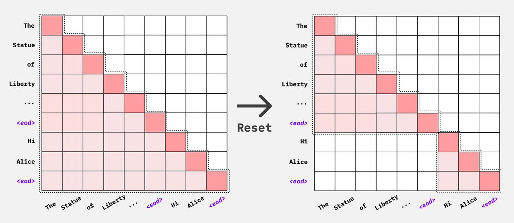

## Visualization of Multipack with Flash Attention

Because Flash Attention simply drops the attention mask, we do not need to
construct a 4d attention mask. We only need to concatenate the sequences into
a single batch and let flash attention know where each new sequence begins.


4k context, bsz =4,
each character represents 256 tokens
X represents a padding token

```
   0 1 2 3 4 5 6 7 8 9 0 1 2 3 4 5
[[ A A A A A A A A A A A ]
   B B B B B B ]
   C C C C C C C ]
   D D D D ]]

[[ E E E E E E E E ]
 [ F F F F ]
 [ G G G ]
 [ H H H H ]]

[[ I I I ]
 [ J J J ]
 [ K K K K K]
 [ L L L ]]
```

after padding to longest input in each step
```
   0 1 2 3 4 5 6 7 8 9 0 1 2 3 4 5
[[ A A A A A A A A A A A ]
   B B B B B B X X X X X X ]
   C C C C C C C X X X X ]
   D D D D X X X X X X X ]]

[[ E E E E E E E E ]
 [ F F F F X X X X ]
 [ G G G X X X X X ]
 [ H H H H X X X X ]]

[[ I I I X X ]
 [ J J J X X ]
 [ K K K K K ]
 [ L L L X X ]]
```

w packing ( note it's the same effective number of tokens per step, but a true bsz of 1)
```
   0 1 2 3 4 5 6 7 8 9 0 1 2 3 4 5
[[ A A A A A A A A A A A B B B B B
   B C C C C C C C D D D D E E E E
   E E E E F F F F F G G G H H H H
   I I I J J J J K K K K K L L L X ]]
```

cu_seqlens:
[[ 0, 11, 17, 24, 28, 36, 41 44, 48, 51, 55, 60, 64]]


## Multipack without Flash Attention

Multipack can still be achieved without Flash attention, but with lower packing
efficiency as we are not able to join multiple batches into a single batch due to
context length limits without flash attention. We can use either Pytorch's Scaled
Dot Product Attention implementation or native Pytorch attention implementation
along with [4d attention masks](https://github.com/huggingface/transformers/pull/27539)
to pack sequences together and avoid cross attention.



## Multimodal sample packing

Sample packing also works for multimodal (VLM) runs. It packs pre-tokenized VLM rows into full-length sequences at the sampler level and concatenates their tensors (including media such as `pixel_values`) at collation. For multimodal, packing automatically uses the balanced-greedy knapsack strategy rather than first-fit-decreasing, which distributes variable-length image rows more evenly across bins.

There are two multimodal packing paths. The default for a **prepared** (pre-tokenized, cached-to-disk) dataset globally knapsacks rows by their `length` column at the sampler level and reuses the cache — this is the recommended path. For a **streaming or non-prepared** dataset (`streaming: true` or `skip_prepare_dataset: true`) there is no cached `length`/media, so packing instead uses a buffered packer (see below). Multimodal packing with `pretraining_dataset` is **not** supported and raises (media would be silently dropped) — use `streaming: true` with a `datasets:` entry instead. Either way you must set `remove_unused_columns: false` so the media columns survive collation; Axolotl raises a clear error if it is not false.

```yaml
processor_type: AutoProcessor
sample_packing: true
remove_unused_columns: false
# leave skip_prepare_dataset unset for the default prepared/global-packing path
```

::: {.callout-warning}
The prepared path caches the processor-expanded media (e.g. float `pixel_values`) into `dataset_prepared_path`. That is far larger than the source images — tens of MB per high-resolution image row for patch-based processors — so budget disk accordingly or use the buffered path for large image datasets.
:::

### Buffered multimodal packing (streaming / non-prepared)

When the dataset is streaming or not prepared, multimodal packing runs through a buffered packer: rows are tokenized on the fly into a bounded lookahead buffer (`mm_pack_buffer_size`, default 1000 rows), each full buffer is packed with the same balanced-greedy knapsack, and every bin is emitted as one packed sequence. Buffered rows hold decoded media (`pixel_values`) in memory — at high image resolutions the default buffer can reach several GB of RAM, so lower `mm_pack_buffer_size` if memory is tight (smaller buffers pack slightly less efficiently). This unblocks `streaming: true` and `skip_prepare_dataset: true` for multimodal `sample_packing` (`pretraining_dataset` is not supported for multimodal packing and raises). Two limitations are accepted: packing is **non-deterministic** across runs (bins depend on buffer-boundary arrival order, so it is not reproducible from a seed), and it is **single-process only** (`dataloader_num_workers` is forced to 0 to avoid duplicated rows, since the buffered packer has no worker sharding yet; multi-GPU / cross-rank packing is a follow-up). Prefer the prepared path when you need reproducible, globally-optimal packing.

On the **prepared** path, `excess_length_strategy: truncate` never slices a multimodal row: truncating its input_ids would desync the expanded image tokens from `pixel_values`, so an over-long media row raises instead. Use `excess_length_strategy: drop` (the default) or raise `sequence_len` to handle over-long multimodal rows. The **buffered / streaming** path does not truncate or raise either — it silently **drops** any row longer than `sequence_len` (logging a one-time warning), since such a row can never fit a packed bin.

Cross-attention vision models (e.g. mllama / Llama-3.2-Vision), whose inputs carry a `cross_attention_mask`, are not supported for sample packing: the packed mask would need a block-diagonal layout over the pack's total images that the collator does not yet build, so packing raises a clear error for them — set `sample_packing: false` for those models.

### mRoPE models (Qwen2-VL, Qwen2.5-VL, Qwen3-VL, GLM4V)

Models with multimodal rotary embeddings only isolate packed samples when transformers receives `[4, batch, seq]` position ids: a text-position row followed by the temporal, height and width grids. A plain `(batch, seq)` row is expanded to three identical grids, which silently disables both the block-diagonal mask and `get_rope_index`, so every sample in a pack attends to the ones before it and image tokens lose their 2-D positions. Axolotl handles this with a forward pre-hook on the model (installed automatically when `sample_packing` is on for a multimodal run): it computes the mRoPE grids for the packed row, restarts them at every pack boundary, and prepends the text row. Packed loss matches unpacked loss to fp32 precision on Qwen2-VL, Qwen2.5-VL (images and videos) and Qwen3-VL; GLM4V shares the same position-id construction but has not been run.

::: {.callout-warning}
Do not set `multipack_real_batches: true` with flash attention for multimodal packing. transformers' flash path only reads packed sequence boundaries from position ids when the batch is a single row, so multi-row batches attend across packs. The default (one pack of `micro_batch_size * sequence_len` tokens per step) is isolated; sdpa isolates multi-row batches through its block-diagonal mask.
:::

Multimodal packing has been validated for loss parity against unpacked runs on **Qwen2-VL, Qwen2.5-VL, Qwen3-VL, SmolVLM/Idefics3**, and end-to-end (real forward/backward) on **InternVL3 and Gemma3**, with Pixtral's variable-resolution `pixel_values` validated against its vision tower. Other decoder-only VLMs that represent images as in-sequence tokens may work through the same collation paths but are **untested** — sample isolation inside a pack depends on the text tower's attention handling, so verify loss parity against an unpacked run before relying on packing for an unlisted architecture. Audio models (e.g. Voxtral) are not supported; packing raises on their processor outputs.

See `examples/qwen2_5-vl/lora-7b-packed.yaml` for a runnable config.

## Balancing supervised tokens

A full batch does not always contain the same amount of training signal. For
example, a long prompt with a short answer may occupy as much space as a short
prompt with a long answer, but contribute far fewer tokens to the loss when
prompt tokens are masked. We call the tokens that contribute to the loss
*supervised tokens*, or *labels*.

Enable label balancing to make the amount of supervision more consistent:

```yaml
sample_packing: true
balance_labels: true
```

Axolotl first packs samples to use the available space, then adjusts their
placement to balance supervised-token counts. It keeps the retained samples and
respects the packing capacity without increasing total padding. Samples stay
whole, so batches will not always have exactly equal label counts.

This is most useful when answer lengths vary widely or prompts make up very
different fractions of your samples. Fully supervised pretraining may benefit
less because almost every input token already contributes to the loss.

### Using it without packing

Label balancing also works with ordinary padded batches or with batch flattening:

```yaml
sample_packing: false
batch_flattening: true
balance_labels: true
micro_batch_size: 4
```

Each full microbatch still contains four samples. Set `batch_flattening: false`
to use ordinary padded batches instead. In both modes, Axolotl balances label
counts and batch sizes while keeping the number of samples per microbatch fixed.
For padded batches, it also avoids adding extra padding.

With sample packing, the number of original samples in a microbatch can vary.
With packing-aware attention and the default layout, a rank receives one packed
row with capacity `micro_batch_size * sequence_len`. If you enable
`multipack_real_batches`, it receives `micro_batch_size` packed rows, each with
capacity `sequence_len`.

Training packing uses the trainer's effective batch size, including adjustments
from automatic batch-size reduction and single-process DataParallel. Evaluation
packing uses the effective evaluation batch size independently. This applies
with or without label balancing and to both packed layouts: one row gets a
capacity of effective batch size × sequence length, while `multipack_real_batches`
uses that many rows with a sequence-length capacity each.


### Gradient accumulation and multiple GPUs

A *microbatch* is what one rank processes in one forward/backward pass. An
*optimizer step* combines the work of all data-parallel ranks across the
configured gradient accumulation steps. For example, four ranks with
`gradient_accumulation_steps: 4` contribute 16 microbatches to each optimizer
step.

For non-streaming datasets, label balancing also makes the total supervision per
optimizer step more consistent. It then adjusts samples within each step to
reduce differences between its microbatches, without changing that step's total
labels or tokens. This adjustment helps when unpacked microbatches contain
multiple samples, or when sample packing is enabled.

To also refine the balance across several optimizer steps, set:

```yaml
balance_labels: true
label_balance_window_optim_steps: 32
```

The default is `1`, which only refines microbatches within each optimizer step.
Larger values allow sample swaps across that many complete optimizer steps,
while protecting both token-count and label-count variance at the step level.
Axolotl then refines microbatches within each step. A larger window can improve
balance, but takes more CPU time to prepare and does not guarantee an improvement.

The window counts optimizer steps, not individual ranks or microbatches. For
example, a window of `8` with four data-parallel ranks and gradient accumulation
of four covers 128 rank-local microbatches. Context- and tensor-parallel ranks do
not multiply that count. An incomplete window still receives within-step
refinement. Keep this setting unchanged when resuming a checkpoint.
Windows larger than `1` require non-streaming training; streaming preprocessing
chunks do not identify the eventual optimizer-step boundaries.

With multiple data-parallel ranks, a final ordering pass tries to make consecutive
microbatches on each rank closer in size. It keeps each optimizer step’s samples
and label/token totals intact, and protects the existing balance between ranks
at simultaneous microsteps. Larger jobs use a bounded search rather than trying
every possible rank assignment.

These adjustments do not guarantee equal memory use or runtime. In ordinary
padded batches, one long sample can still determine the size of the whole batch.
They also do not guarantee equal workloads across ranks or smooth size changes
between consecutive microbatches on a rank. Label balancing complements the
trainer's token-weighted loss normalization; it does not replace it.

### Checking the results

Compare the before and after sampler statistics to see whether balancing helps
your dataset:

| Statistic | What it tells you |
|---|---|
| Mean unpadded length | How many input tokens a typical microbatch contains, excluding padding |
| Label-count standard deviation | How much supervision varies between microbatches; lower means more consistent counts |
| Optimizer-step label standard deviation | How much total supervision varies between optimizer steps |
| Padding tokens | Space spent on padding rather than input tokens |

For a fixed set of retained samples and batches, balancing should leave mean
label counts unchanged. Look for reduced variation, rather than a higher mean.
The statistics describe the generated schedule, not measured GPU memory or
throughput. Optimizer-step statistics exclude incomplete final steps.

### Compatibility and checkpoint resume

Use label balancing with causal language-model training and right padding. Labels
must be known after tokenization; custom collators that change which tokens are
supervised are not supported. Unpacked modes require a non-streaming dataset and
the standard padded or flattening collator. Keep
`accelerator_config.split_batches: false`, the default whole-batch sharding
behavior.

Label balancing cannot be combined with curriculum/sequential sampling, reward
models, diffusion, or RL training. Unpacked modes also cannot be combined with
length-grouped sampling. Balancing applies to training only; evaluation keeps its
existing sampling behavior.

Streaming SFT and pretraining support balancing within each packing buffer,
controlled by `streaming_multipack_buffer_size`. They do not balance across
optimizer steps because those steps can span buffer boundaries. Each chunk uses
a seed derived from its tokenized contents and `data_seed` (falling back to
`seed`), so replaying the same chunk reproduces its packing.

For non-streaming checkpoint resume, keep the dataset order, seed, batching and
packing settings, data-parallel size, and gradient accumulation unchanged. Leave
`ignore_data_skip: false` so the trainer resumes at the correct position in the
reconstructed schedule. New checkpoints also record sampler settings and the
consumed-batch position, and reject incompatible replay settings. Older
checkpoints use the saved epoch position, with an optimizer-step boundary check.
Streaming uses its existing iterable-dataset resume behavior.


For exact balanced-sampler replay, keep the dataset's row order, sample lengths,
label counts, and sampler settings unchanged. A changed dataset fingerprint
produces a warning if the sampler metadata still matches; that metadata verifies
the ordering inputs, not the full text of each example. A changed data-parallel
size or batching setting can prevent exact replay.

If exact replay is unavailable, `ignore_data_skip: true` allows training to resume
without restoring the previous data position. Samples may be repeated or skipped.
If sampler-position bookkeeping fails while saving, Axolotl still saves the model
and optimizer checkpoint, but marks exact sampler replay as unavailable.
